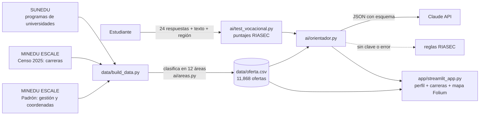

# 🧭 Rumbo

> **Ayudamos a estudiantes de 5.º de secundaria y a sus tutores a elegir qué estudiar y dónde, mediante un test vocacional con IA que muestra todas las opciones reales cerca de casa (universidades, institutos, pedagógicos y CETPRO, públicos y privados) usando datos abiertos de SUNEDU y MINEDU.**

**Demo:** https://rumbo-peru.streamlit.app

---

## 1. One-liner
Hacemos **orientación vocacional con todas las opciones reales** para **estudiantes de 5.º de secundaria y sus tutores** mediante **un test RIASEC interpretado con IA y cruzado con 11,868 ofertas de estudio oficiales**.

## 2. Founder
**Noelia Fernanda León Ruiz**: founder de Rumbo.

Participante de la **Diplomatura de Especialización en Ciencia de Datos para las Ciencias Sociales y la Gestión Pública (Q-Lab PUCP)**. Creo que ningún estudiante del Perú debería elegir su futuro solo con la publicidad de las universidades privadas o con lo poco que conoce de su entorno. Mi trabajo en Rumbo consiste en convertir datos públicos que están dispersos (SUNEDU, el Censo Educativo del MINEDU, el MEF) en una herramienta que un estudiante, su familia y su tutor entienden en minutos. Así, cada joven puede ver **todas** sus opciones reales, públicas y privadas, universitarias y técnicas, cerca de casa.

Cómo cubro cada rol con agentes de IA:
| Rol | Cómo |
|---|---|
| Producto | Entrevistas a usuarios (`docs/research/`) y priorización de un solo flujo |
| Ingeniería | Claude Code como co-founder técnico: pipeline de datos, app y pruebas |
| Diseño | Streamlit + mapa Folium; un flujo de 3 pasos: test → resultados → dónde estudiar |
| Ventas | Reporte descargable para el tutor: lo que compra el colegio |

## 3. Problema
**Quién lo sufre:** los estudiantes de 5.º de secundaria de colegios públicos fuera de Lima y sus **tutores**, que orientan a decenas de alumnos cada uno con charlas y fichas en papel.

**Qué les cuesta:**
- Elegir mal significa perder años y dinero: cambiarse de carrera o dejar los estudios. Según el MINEDU, la **deserción universitaria fue de 12 % en 2019** y subió a **18.2 % en 2020-I** ([Infomercado](https://infomercado.pe/minedu-300-mil-universitarios-dejaron-de-estudiar-en-el-2020/)). El II Informe Bienal de SUNEDU (2020) muestra que el abandono es mayor **fuera de Lima (13.4 %)** y llega a **24.6 % en la selva** (citado en [Revista Horizontes](https://revistahorizontes.org/index.php/revistahorizontes/article/view/1719/2943)).
- La mayoría de los tests gratuitos los hacen universidades privadas y llevan a su propia oferta. **El 81 % de la oferta pública de educación superior no es universitaria** (institutos tecnológicos, pedagógicos y CETPRO, según nuestro cálculo con datos de SUNEDU y MINEDU), y esas opciones casi nunca aparecen en esos tests.

**Cómo lo resuelven hoy:** con charlas de las universidades que visitan el colegio, preguntando a familiares o con búsquedas sueltas en Google. Ponte en Carrera (MINEDU) informa sobre carreras, pero no parte de los intereses del estudiante.

**Evidencia:** las notas de 3 conversaciones con usuarios potenciales están en [`docs/research/`](docs/research/).

## 4. Solución e insight
**Qué construí:** una app web con tres pasos:
1. **Test vocacional** de 24 preguntas (modelo RIASEC de Holland, con redacción propia) y un campo libre para que el estudiante cuente con sus palabras qué le gusta.
2. **Perfil y carreras sugeridas:** Claude interpreta los puntajes y el texto, y recomienda de 5 a 6 programas elegidos **solo de la lista oficial**. La app valida que cada programa exista en los datos.
3. **Dónde estudiar:** un mapa y una tabla con cada institución que ofrece esa carrera en la región, con filtros de **pública o privada** y de tipo, y enlace a la web oficial de cada una.
4. **Comparar:** hasta 4 instituciones lado a lado (por ejemplo, Enfermería en una universidad pública frente a Enfermería Técnica en un instituto). Muestra el título que se obtiene, la duración y el costo, y un **perfil de egreso referencial** por carrera y nivel, generado con IA y marcado como referencial. Al final se descarga un reporte para el tutor.

**Insight:** el problema no es la falta de tests, sino que **los tests no muestran el mapa completo**. Un estudiante de Ayacucho con perfil Social-Investigador encuentra Enfermería Técnica en **14 lugares de su región, 10 de ellos públicos**. Ninguna universidad le va a mostrar esa opción.

## 5. Why now
- **Datos abiertos que antes no estaban unidos:** SUNEDU publica los programas de las 95 universidades licenciadas con coordenadas, y el Censo Educativo 2025 del MINEDU publica las carreras de cada instituto. Rumbo los junta por primera vez en una sola tabla.
- **LLMs con salidas estructuradas:** hoy un modelo puede explicar un perfil en lenguaje cálido y devolver un JSON validado contra un esquema, por centavos. Hace tres años eso costaba un psicólogo por estudiante o un sistema de reglas rígido.
- **Despliegue gratis:** Streamlit Community Cloud permite tener una URL pública sin servidor propio.

## 6. Demo
- **URL:** https://rumbo-peru.streamlit.app
- **Correr en local:**
  ```bash
  pip install -r requirements.txt
  streamlit run app/streamlit_app.py
  # opcional: copia .env.example a .env y agrega ANTHROPIC_API_KEY para activar la IA
  ```
- **Capturas:** `docs/capturas/1_test.png`, `docs/capturas/2_perfil.png`, `docs/capturas/3_mapa.png`

**Arquitectura**


**Modelos y APIs:**
- **Claude (`claude-opus-5-5`, configurable con `CLAUDE_MODEL`)** con *structured outputs*. Se usa porque garantiza un JSON con el esquema exacto, explica bien en español y con esfuerzo `low` cuesta centavos. La respuesta se valida contra los datos: si el modelo nombra una carrera que no existe, se descarta.
- **Plan B sin IA:** si no hay API key o la llamada falla, `recomendar_reglas()` da una recomendación con el modelo RIASEC. La demo nunca se cae.
- **No se guardan datos personales:** las respuestas viven solo en la sesión del navegador.

## 7. Modelo de negocio
| Plan | Quién paga | Precio | Qué incluye |
|---|---|---|---|
| Estudiante | Nadie | Gratis | Test, carreras y mapa |
| Colegio | Colegio privado o APAFA | **S/ 8 por estudiante al año** | Reportes por aula para el tutor y una charla guiada |
| UGEL / DRE | Gobierno regional | **S/ 2,500 por UGEL al año** | Panel con las tendencias vocacionales de la región |

**Costo por usuario:**
- IA: unos 3,000 tokens de entrada y 800 de salida con Claude Opus 5.5 ($4 / $20 por millón) cuestan alrededor de **US$ 0.03 (≈ S/ 0.11) por test**.
- Servidor: S/ 0 en Streamlit Community Cloud mientras el uso sea bajo.
- **Margen de contribución en el plan Colegio:** unos S/ 7.9 de S/ 8 por estudiante (98 %).

## 8. Herramientas del curso
| Herramienta | Sesión | Dónde está | Por qué |
|---|---|---|---|
| **LLM con salidas estructuradas** | 08 | [`ai/orientador.py`](ai/orientador.py) | Convierte puntajes y texto libre en una recomendación con un JSON validado |
| **Mapas con Folium** | 06 | [`app/streamlit_app.py`](app/streamlit_app.py) (sección «Dónde estudiar») | El estudiante ve qué tiene cerca, en verde lo público y en azul lo privado |
| **Dashboards** | 05 | [`app/streamlit_app.py`](app/streamlit_app.py) | Métricas y gráficos de la oferta |
| **Datos abiertos y APIs** | 03 | [`data/build_data.py`](data/build_data.py) | Descarga y une SUNEDU y el Censo Educativo del MINEDU |

## 9. Qué hizo el agente
Construí Rumbo con **Claude Code** como co-founder técnico:
- **Claude Code** encontró las fuentes (SUNEDU en datosabiertos.gob.pe y el Censo 2025 en ESCALE), escribió `data/build_data.py`, propuso la clasificación por palabras clave de `ai/areas.py`, el test, el orientador con salida estructurada y la app en Streamlit, y la probó de forma automática con `streamlit.testing`.
- **Yo:** elegí el problema, hice las entrevistas, decidí el usuario y el modelo de negocio, revisé la clasificación de carreras y dirigí cada iteración del producto: pedí la separación público/privado, el comparador y el perfil de egreso por carrera; detecté que faltaban las escuelas de la Ley 30512 (como la EESPP Monterrico) y las escuelas nacionales de arte; aporté sus webs, la dirección de la Escuela de Folklore y la fuente del pliego Educación en Transparencia MEF; revisé las preguntas del test y definí el diseño (colores, mapas, navegación por pasos).

---

### Sobre el test vocacional
- Se basa en el **modelo RIASEC de Holland**: 6 tipos de interés y 24 preguntas en **4 secciones temáticas** (actividades, lugares de trabajo, temas y otras actividades), con una pregunta de cada tipo por sección, en `ai/test_vocacional.py`. Las palabras poco conocidas tienen una ayuda ⓘ.
- Las preguntas son **de redacción propia** y siguen el formato de los marcadores RIASEC de dominio público (AFPD; Armstrong y otros, 2008), validados en español por [Cupani y otros (2019)](https://core.ac.uk/download/343669628.pdf). Cada pregunta tiene una sola actividad, mide un solo tipo de interés y es posible en cualquier región, sin suponer acceso a computadora. **No son una traducción del instrumento AFPD.**
- **Próximo paso:** validar el test con respuestas reales (consistencia por tipo de interés, alfa de Cronbach).

### Correcciones manuales (transparentes)
- **`data/correcciones_manuales.csv`:** nombres oficiales y webs verificadas a mano. Por ejemplo, la EESPP Monterrico y la Escuela Nacional Superior de Ballet, que en el padrón figuran con su nombre corto.
- **`data/programas_manuales.csv`:** programas verificados a mano para escuelas cuyo censo no reporta especialidades. Por ejemplo, los 7 programas de la EESPP Monterrico (Educación Inicial, Primaria, Secundaria en 4 especialidades e Idiomas-Inglés).
- **`data/instituciones_extra.csv`:** escuelas nacionales de arte con rango universitario que no están en SUNEDU ni en el padrón del MINEDU: Folklore José María Arguedas, Bellas Artes (ENSABAP) y Arte Dramático (ENSAD). Su fuente es su web oficial y su registro como unidades del pliego Educación en Transparencia Económica del MEF. La ubicación viene de OpenStreetMap; la de Folklore es aproximada (Av. Petit Thouars 421).
- **`ai/perfiles_carreras.py`:** catálogo de perfiles de egreso referenciales para unas 45 carreras, que cubre el 97 % de la oferta. Cada perfil tiene competencias distintas para formación universitaria y técnica.

### Datos y limitaciones
- **Fuentes:** SUNEDU, Programas de universidades licenciadas (corte de agosto de 2024), y MINEDU ESCALE, Censo Educativo 2025 (padrón y cuadro de carreras).
- Los institutos pedagógicos no reportan sus especialidades en ese cuadro, así que aparecen como «Formación docente».
- La clasificación por áreas es por palabras clave, por lo que hay casos dudosos.
- Para regenerar la tabla: `python data/build_data.py`.

**Licencia:** MIT
